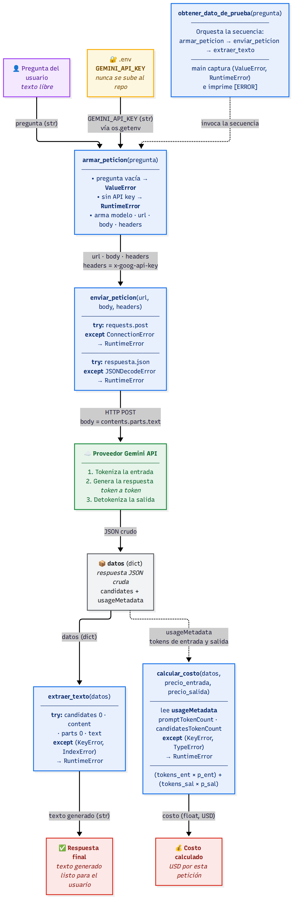

# Decisión de arquitectura: elección de modelo

**Fecha de la decisión:** 2026-10-20
**Alcance:** modelo de lenguaje detrás de la miniaplicación (`src/consumir_gemini.py`).

## Modelo elegido

**`gemini-2.5-flash`**, para la funcionalidad principal de la miniaplicación.

Queda como modelo por defecto en `armar_peticion(pregunta, modelo="gemini-2.5-flash")`, siempre invocable con otro modelo por parámetro.

## Diagrama de arquitectura

El flujo completo va desde la pregunta del usuario hasta la respuesta final: `armar_peticion` arma URL, cuerpo y headers y lee `GEMINI_API_KEY` desde `.env`; `enviar_peticion` envía la petición, valida que la respuesta traiga `error` o `candidates` y devuelve la respuesta cruda; de esa misma respuesta cruda, `extraer_texto` extrae el texto generado y `calcular_costo` calcula el costo de la petición a partir de `usageMetadata`. Cada función tiene su propio manejo de errores (`try/except`), y el orquestador `obtener_dato_de_prueba` (junto con `main`) captura `ValueError` y `RuntimeError` para mostrar un mensaje amigable. El diagrama completo, con las etiquetas de cada flecha, está en [`docs/tarea_modulo1_bloque8/`](../tarea_modulo1_bloque8/diagrama_arquitectura.png).

## Comparación de candidatos

Datos medidos con `src/comparar_modelos.py` (4 corridas de latencia por modelo con la misma pregunta, 3 preguntas de calidad, disponibilidad contada sobre los 7 intentos). Precios de la página oficial de precios de Google AI (`ai.google.dev/gemini-api/docs/pricing`), tarifa Standard pagada, convertidos de USD/1M tokens a USD/1000 tokens.

| Criterio | gemini-2.5-flash (elegido) | gemini-3.6-flash (descartado) |
|---|---|---|
| Costo por 1000 tokens de entrada | 0,0003 USD | 0,00075 USD |
| Costo por 1000 tokens de salida | 0,0025 USD | 0,00375 USD |
| Costo real por petición observado | 0,000013 – 0,000021 USD | 0,000038 USD |
| Latencia promedio observada (4 corridas) | 4,39 s | 3,21 s |
| Calidad de respuesta para el caso | Buena: responde lo esencial con claridad en las 3 preguntas de prueba | Muy buena: respuestas más elaboradas, pero solo 1/3 respondidas en la corrida final (las otras 2 fallaron por cuota) |
| Disponibilidad observada (7 intentos) | 7/7 ok | 5/7 — 2 fallos con `429 RESOURCE_EXHAUSTED` |
| Fecha de medición | 2026-10-20 | 2026-10-20 |

**Observaciones de la medición (transparencia):**

- Los 2 fallos de `gemini-3.6-flash` en la corrida fueron `429 RESOURCE_EXHAUSTED` por **cuota del free tier** (el mensaje del servicio indica `limit: 20` peticiones para ese modelo). Las corridas de esta sesión consumieron esa cuota; en un producto real eso significa que un volumen bajo de uso satura el tier gratuito de ese modelo.
- En pruebas previas del mismo día, antes de agotar la cuota, `gemini-3.6-flash` también respondió con errores `503 UNAVAILABLE` ("This model is currently experiencing high demand"), que sí son de disponibilidad del servicio, no de cuota.
- `gemini-2.5-flash` respondió todas las peticiones del día (las 7 de la corrida más las pruebas previas) sin agotar cuota ni mostrar errores.
- La latencia de `gemini-3.6-flash` salió **más baja** en este muestreo (3,21 s vs 4,39 s). Lo reportamos tal cual: es el vértice en el que el candidato descartado gana.
- Los precios de `gemini-3.6-flash` son promocionales hasta el 2026-12-31 y **duplican desde 2027-01-01** (entrada 0,0015 USD / salida 0,0075 USD por 1000 tokens), lo que amplía la brecha de costo con el tiempo.

## Justificación

Para esta miniaplicación —un asistente simple de pregunta→respuesta, donde "cubrir lo esencial" satisface lo que el usuario necesita— el criterio que más pesó fue el **costo por interacción y la disponibilidad combinados**.

La miniaplicación no tiene un requisito real de respuestas más elaboradas: en las 3 preguntas de prueba, `gemini-2.5-flash` cubre lo esencial con claridad. Sobre esa base, `gemini-2.5-flash` cuesta aproximadamente la mitad por petición observada (0,000013–0,000021 USD vs 0,000038 USD), es 2,5× más barato en tokens de entrada y 1,5× en tokens de salida, y respondió el 100% de los intentos mientras el otro candidato no completó la muestra por límites de uso del proveedor.

Según el triángulo costo / latencia / calidad, no se optimizan los tres a la vez: aquí se **cede el vértice latencia** (3,21 s de `gemini-3.6-flash` frente a 4,39 s de `gemini-2.5-flash`, ambos aceptables para este caso) a cambio de ganar en costo y en disponibilidad, sin sacrificar la calidad que el caso necesita. La latencia observada de `gemini-2.5-flash` (rango 2,87 – 5,73 s) es tolerable para un asistente de este tipo, donde el usuario espera una respuesta en pocos segundos.

Un factor adicional, del eje escala: los límites de uso del proveedor. La cuota gratuita del candidato descartado se agotó con pocas decenas de peticiones y su precio duplica a fin de año; conocer eso **antes** de elegir, y no cuando la aplicación crezca, es exactamente lo que este registro busca dejar documentado.

## Alternativa descartada y por qué

Se descartó **`gemini-3.6-flash`**. Ofrece respuestas con más detalle y menor latencia promedio en la medición, pero esa ventaja no se justifica para este caso por tres razones concretas: (1) el costo por interacción es aproximadamente el doble y sus precios promocionales duplican desde 2027-01-01; (2) en las mediciones reales no completó la muestra por límites de uso del proveedor (`429 RESOURCE_EXHAUSTED` con cuota de 20 peticiones en el free tier) y mostró errores `503 UNAVAILABLE` por alta demanda, mientras el modelo elegido respondió en todos los intentos; (3) el nivel de detalle adicional de sus respuestas no es un requisito real de una miniaplicación de asistente simple, donde cubrir lo esencial ya satisface al usuario.

---

**Evidencia asociada:** [`comparativa_modelos.json`](comparativa_modelos.json) (corridas completas: tiempos por intento, tokens, costos, respuestas y causas de fallo). Mediciones generadas por [`src/comparar_modelos.py`](../../src/comparar_modelos.py).
